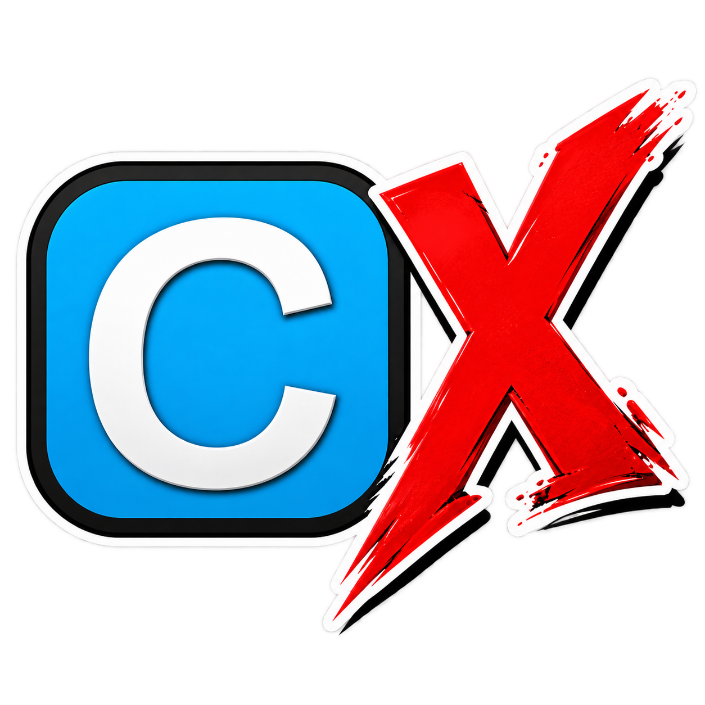

# CemuX

CemuX is a Windows x64 Wii U emulator derived from Cemu. It adds game fixes, native Wii U Menu/HOME/manual support, expanded Wii Remote and Bluetooth support, native amiibo, and a built-in link to [AzaharX](https://github.com/GamesExObscura/AzaharX) for games that connect a Wii U and a 3DS.

## Credits

CemuX is a separate build derived from Cemu, the Wii U emulator created by Exzap and the Cemu developers and contributors. Their work is the foundation of this project, and their copyright notices, license and credits are kept intact. CemuX is not an official Cemu release and is not affiliated with or supported by the Cemu project, so please do not ask them for help with it.

## Download

Get the latest zip from [Releases](../../releases), extract it somewhere safe, and run `CemuX.exe`. Keep `resources`, `gameProfiles`, `native-home`, `native-manual` and `cafe-au-lait` beside it.

## What's different from Cemu

- Game compatibility fixes (Watch Dogs, The Amazing Spider-Man, ZombiU, NBA 2K13 and others), corrected Mii rendering and Smash portraits.
- Original HOME menu and game manuals, game closing/switching and Start in Wii U Menu, run as supervised helper processes.
- Wii Remote, MotionPlus and Nunchuk support with hotplug, automatic allocation, battery reporting and speaker audio.
- Bluetooth passthrough using a dedicated USB adapter with WinUSB ([setup](docs/USB-BLUETOOTH-PASSTHROUGH.txt)).
- Virtual Guitar Hero Live controller.
- Cafe au Lait: a companion Wii U app and importer for bringing your own console system/account files into CemuX ([Cafe au Lait repository](https://github.com/GamesExObscura/Cafe-au-Lait)).
- Native amiibo registration and writable BIN support.
- Wii U / 3DS Link with AzaharX over the same PC or LAN ([setup](docs/WIIU-3DS-LAN.txt)).
- Per-game GX2 full-sync controls and several stability and responsiveness fixes.

See the [release notes](RELEASE_NOTES.md) for details and limits.

## Known limits

- Windows x64 only.
- Some Wii Remote speaker crackle remains. Physical Guitar Hero Live guitar testing is pending.
- Direct Internet link connections are experimental. Monster Hunter 3 Ultimate Internet play has not been verified.
- HOME and manuals use helper processes, not true in-process emulation.
- Only a USB-BT600 adapter has been tested for Bluetooth passthrough.

## What you must provide

CemuX includes no games, keys, firmware, console dumps, saves or amiibo data. Dump your own from hardware you own. Never share them.

## Building

See [BUILD.md](BUILD.md). On Windows, `pwsh -File .\Build-CemuX.ps1` does a normal source build. Run `tools/package-native-home-runtime.ps1` to bundle the helper processes next to your build.

## Issues

Bug reports are welcome in this repository's Issues. Please include your log and say whether you used the link, passthrough or helper features.
## License

[Mozilla Public License 2.0](LICENSE.txt), the same as Cemu. Files in `dependencies` and some files in `src` keep their original licenses, as stated in their headers. Third-party notices ship in the release's `licenses` folder. Copyright in their code remains with the original Cemu authors.
